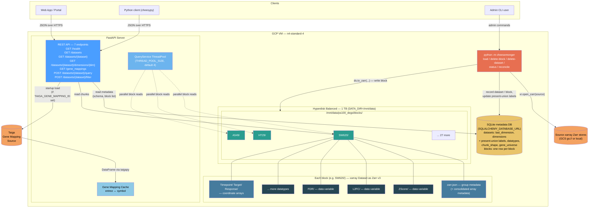
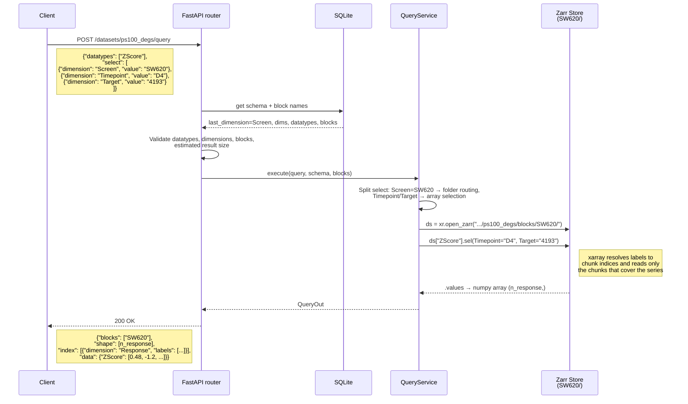
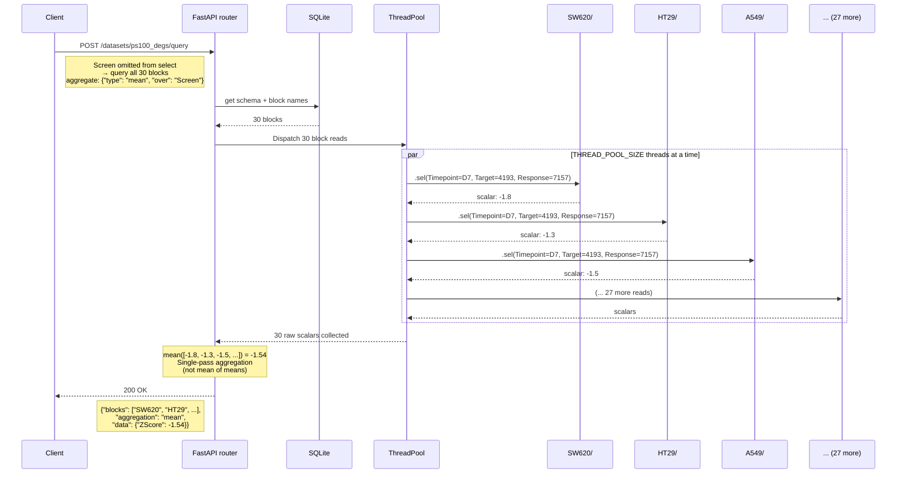
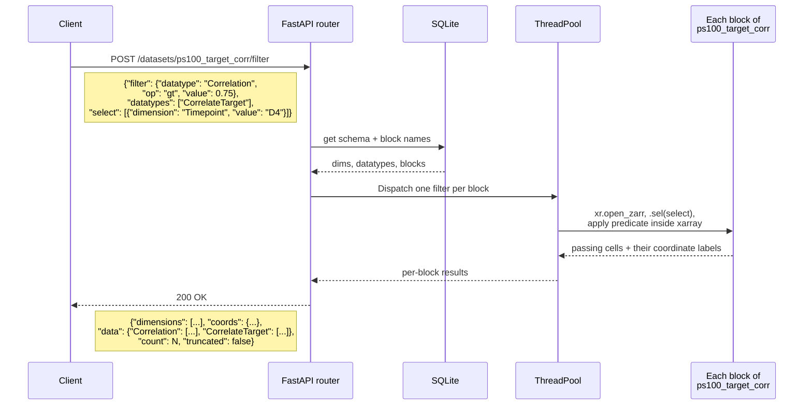
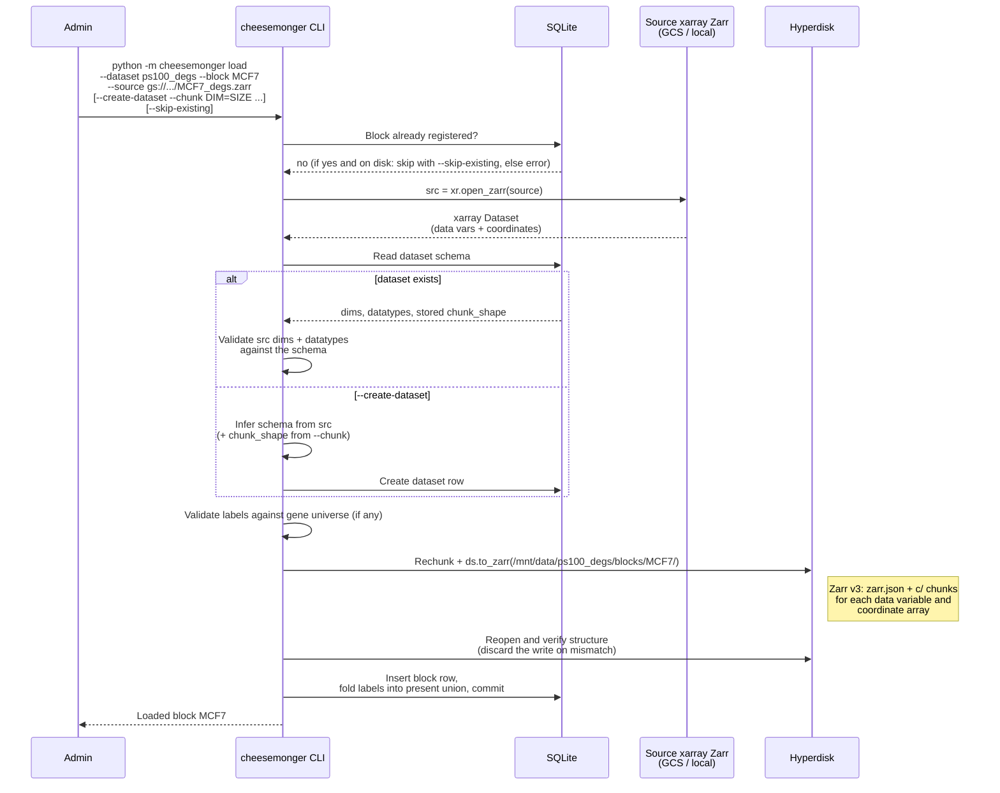

# Cheesemonger Architecture

Dimension names in these diagrams follow the deployed data: `Timepoint`, `Target`
(knocked-out gene), `Response` (measured gene), with the block key (last
dimension) `Screen`. Dataset and block names (`ps100_degs`, `SW620`, ...) are
illustrative.

## System Architecture

### Components

| Component | Role |
|-----------|------|
| **FastAPI Server** | Serves the read-only REST API (7 endpoints, listed below). Validates requests with Pydantic, reads dataset metadata from SQLite, and reads block data via `xr.open_zarr()`. The routers in `cheesemonger/api/` never touch disk directly. They go through `services/`. |
| **QueryService ThreadPool** | Parallelizes multi-block reads within a single `/query` or `/filter` request. Each block read opens the store once and pulls all requested datatypes. Size set by `THREAD_POOL_SIZE` (default 4). |
| **Gene Mapping Cache** | In-memory entrez ↔ symbol mapping, loaded from Taiga at startup when `TAIGA_GENE_MAPPING_ID` is set. Otherwise it is empty and `GET /gene_mappings` returns 404. |
| **SQLite metadata DB** | Source of truth for dataset metadata, accessed via SQLAlchemy (`db.py`, `models/`, `crud/`), at `SQLALCHEMY_DATABASE_URL` (default `sqlite:///./cheesemonger.db`). It stores each dataset's last dimension, dimension names with present-union labels, datatypes, chunk shape and gene universe, plus one row per loaded block. Tables are created at startup by both the app and the CLI (`init_db`). |
| **Hyperdisk** | High-performance block storage mounted at `DATA_DIR` (default `/mnt/data/`). Holds all Zarr data under `{dataset}/blocks/{block}/`. |
| **Block (xarray Dataset as Zarr v3)** | One folder per value of the last dimension (e.g. per screen). Contains an xarray Dataset with data variables (datatypes) and coordinate arrays (dimension labels). Written by the loader via `xarray.Dataset.to_zarr()` (zarr 3.1.1, Zarr format v3). |
| **Taiga** | External data platform. Source of the gene mapping file (and optionally the gene universe used at load time). Accessed via `taigapy`. |
| **Admin CLI** | `python -m cheesemonger load \| delete-block \| delete-dataset \| status \| reconcile`. The only write path. `load` opens a source xarray Zarr store (local or `gs://`), validates it against the dataset schema in SQLite (or infers and creates the dataset with `--create-dataset`), writes the block to disk, and records it in SQLite. Not part of the REST API. |

### Endpoints

| Method | Path | Purpose |
|--------|------|---------|
| `GET` | `/health` | Liveness check plus gene-mapping load status |
| `GET` | `/datasets` | List datasets |
| `GET` | `/datasets/{dataset}` | Dataset schema: last dimension, dimensions, datatypes, blocks, chunk shape |
| `GET` | `/datasets/{dataset}/dimensions/{dim}` | All labels of one dimension (the present union, or the loaded block names for the last dimension), paged with `offset`/`limit` |
| `GET` | `/gene_mappings` | entrez ↔ symbol mapping for client-side translation |
| `POST` | `/datasets/{dataset}/query` | Read datatypes at selected coordinates, optionally aggregated or along a diagonal |
| `POST` | `/datasets/{dataset}/filter` | Return the individual cells of a datatype that pass a predicate (e.g. `Correlation > 0.75`) |

All paths are mounted under `API_PREFIX` if one is set.

---

## Query Flow

How a typical query moves through the system.

### Single-block series query

"Give me the ZScore for SW620 at day 4, target MDM2 (entrez 4193)."

**Latency: ~40 ms** (benchmark: big-chunk Zarr on Hyperdisk, see `data_storage_design.md` §4)

### Multi-block aggregation query

"Average ZScore for TP53 (7157) response to MDM2 (4193) knockout at day 7, across all screens."

**Latency: ~300 ms** (estimate: 30 blocks / 4 threads = ~8 batches × ~40 ms each)

### Value-filter query

"Which target–correlate pairs have Correlation > 0.75 at day 4, across all screens?"

Results are capped by the request's `limit` and by a server-side hard cap
(`MAX_FILTER_ROWS`); `truncated` reports whether the cap was hit.

### Data loading flow (CLI)

To replace a block, run `delete-block` first. It removes the DB row and the
directory, then recomputes the present union from the remaining blocks. There is
no in-place overwrite. `reconcile --dataset NAME` rebuilds the present union from
the blocks on disk.
