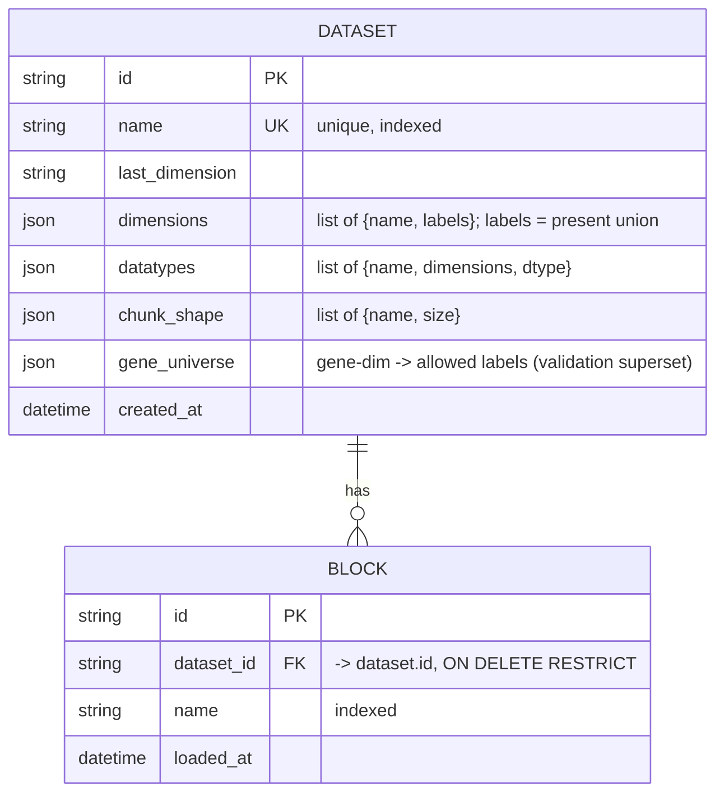

# Cheesemonger Data Model Guide

How cheesemonger models perturb-seq data — the domain concepts, the two stores
that hold them (SQLite metadata + Zarr on disk), their fields and relationships,
the invariants, and how it all maps onto queries and loading.

Companion docs: [data_storage_design.md](data_storage_design.md) (chunking/benchmarks),
[api_design.md](api_design.md) (HTTP contract).

## Contents
1. [The big picture: two stores](#1-the-big-picture-two-stores)
2. [Domain concepts](#2-domain-concepts)
3. [Metadata model (SQLite)](#3-metadata-model-sqlite)
4. [The schema payload (JSON columns)](#4-the-schema-payload-json-columns)
5. [Data model (Zarr on disk)](#5-data-model-zarr-on-disk)
6. [How metadata and data connect](#6-how-metadata-and-data-connect)
7. [Invariants & validation](#7-invariants--validation)
8. [Worked example: perturb-scuba / PS-SC-1](#8-worked-example-perturb-scuba--ps-sc-1)
9. [Lifecycle & consistency](#9-lifecycle--consistency)
10. [Known limitations](#10-known-limitations)
11. [Gene universe & present-union labels](#11-gene-universe--present-union-labels)

---

## 1. The big picture: two stores

Cheesemonger splits a dataset into **metadata** and **data**, stored separately:

| | Store | Holds | Accessed via |
|---|---|---|---|
| **Metadata** | SQLite (SQLAlchemy) | what datasets exist, their schema (dimensions, datatypes, present-union labels, gene universe), which blocks are loaded | `crud/` layer |
| **Data** | Zarr directories on disk (a Hyperdisk mounted at `/mnt/data` in prod) | the actual N-dimensional numeric arrays and each block's own coordinate labels | `services/query.py` + `services/loader.py` |

Why split them: metadata is small, relational, and queried constantly (validate a
request, list blocks, check selection labels) — SQLite answers those in
microseconds without opening a single Zarr chunk. The data is large and
array-shaped — Zarr + xarray handle chunked, label-indexed reads. Keeping them
apart means "does block X exist?" and "what are this dataset's datatypes?" never
touch the filesystem.

---

## 2. Domain concepts

| Concept | Definition | PESCA example |
|---|---|---|
| **Dataset** | A named collection sharing one schema. | `perturb-scuba` |
| **Last dimension** | The *organizational key*. Its values are **blocks**, stored as folders — **not** an array axis. Named per dataset at creation (CLI `--last-dimension`, default `Screen`); the name is case-sensitive. | `Screen` |
| **Block** | One value of the last dimension = one independent Zarr store on disk (one screen's data). Dots in block names are normalized to `-` on load/delete. | `PS-SC-1` |
| **Dimension** | An **array axis** inside every block, with an ordered list of coordinate **labels**. | `Timepoint`, `Target`, `Response` |
| **Datatype** | A measured quantity = one array (data variable). Each declares which dimensions it spans (may be fewer than all). | `ZScore`, `L2FC`, `FDR`, `nCtrlCells` |
| **Label** | A coordinate value along a dimension. Genes are stored as **entrez IDs (strings)**. | `Target="23293"`, `Timepoint="D4"` |
| **Chunk shape** | Zarr chunk sizes per dimension, set at dataset creation (`--chunk DIM=SIZE`) and applied to every block (storage/perf tuning). | `[]` (auto, ~8 MiB) |
| **Gene universe** | Per-dataset validation superset for gene dimensions (`{dim: [labels]}`); every block's labels along those dims must fall inside it (§11). | HGNC entrez IDs + `Cas9` |
| **Gene mapping** | Separate entrez↔symbol lookup (from Taiga), served for client-side translation. Not part of any dataset row. | — |

The pivotal idea: **the last dimension is a folder, not an axis.** A query
*refers* to it like any dimension (`Screen="PS-SC-1"`), but resolving it means
"open that block's folder," whereas resolving `Timepoint="D4"` means "slice the
array." This is what makes adding/deleting a screen a folder + one DB row (plus
a present-union label update, §11), never a rewrite of a big array.

---

## 3. Metadata model (SQLite)

Two tables (`models/dataset.py`). Both use a string UUID primary key (`UUIDMixin`).



**`dataset`**

| Column | Type | Notes |
|---|---|---|
| `id` | str (UUID) | primary key |
| `name` | str | **unique**, indexed — the dataset name |
| `last_dimension` | str | the organizational-key name (e.g. `Screen`) |
| `dimensions` | JSON | list of `{name, labels}` — `labels` is the **present union** across loaded blocks (§11) |
| `datatypes` | JSON | list of `{name, dimensions, dtype}` |
| `chunk_shape` | JSON | list of `{name, size}` (may be empty) |
| `gene_universe` | JSON | `{gene_dim: [labels]}` — validation superset; blocks must be a subset (§11). `{}` = no label validation. Not exposed by the API. |
| `created_at` | datetime (tz-aware) | set on insert |

**`block`**

| Column | Type | Notes |
|---|---|---|
| `id` | str (UUID) | primary key |
| `dataset_id` | str (FK) | → `dataset.id`, `ON DELETE RESTRICT` |
| `name` | str | indexed; the block/screen name |
| `loaded_at` | datetime (tz-aware) | set on insert |

**Constraints & relationships**
- `UniqueConstraint(dataset_id, name)` — a block name is unique *within* a dataset (two datasets may both have a `SW620`).
- `Dataset.blocks` is a plain relationship (no ORM cascade) and the FK is `ON DELETE RESTRICT` (enforced via `PRAGMA foreign_keys=ON` in `db.py`), so a dataset row can't be deleted while block rows reference it. `delete-dataset` refuses if blocks remain; with `--force` the loader deletes the block rows first, then the dataset row (§9).
- The block row records only that a block **exists** (name + when loaded). The actual arrays live on disk (§5); there are no per-cell rows.

**Why JSON columns for dimensions/datatypes/chunk_shape/gene_universe?** They're nested,
read/written as a unit, and a dimension can carry 50k+ labels — modeling each
label as a row would be millions of rows for zero query benefit. They're
effectively a document embedded in the dataset row.

---

## 4. The schema payload (JSON columns)

The `dimensions`, `datatypes`, and `chunk_shape` JSON columns store Pydantic
models (`schemas/common.py`), dumped to plain dicts; `gene_universe` is a plain
`{dim: [labels]}` dict. The loader builds them as a `DatasetIn`
(`schemas/dataset.py`) inferred from the first block's source store. Shapes:

**Dimension** — one array axis and its ordered labels.
```json
{"name": "Timepoint", "labels": ["D4", "D7"]}
```
- `name`: `SafeName` (see §7).
- `labels`: `list[str]` (≤ 50,000, checked when the schema is created). Numeric keys (timepoints, ranks) are stored as strings too. This is the **present union** across loaded blocks (§11), in first-seen order — not necessarily any single block's coordinate order.

**DatatypeSpec** — one measured array and the dimensions it spans.
```json
{"name": "ZScore", "dimensions": ["Timepoint", "Target", "Response"], "dtype": "float32"}
```
- `dimensions` is a subset of the dataset's dimension names, in array order. A datatype may span **fewer** dimensions than the full set (a "reduced-rank" or "unbroadcasted" datatype, e.g. `nCtrlCells` over just `["Timepoint"]`); the loader stores it as delivered and the query engine handles it (§10).
- `dtype` defaults to `"float32"`.

**ChunkDim** — an intended chunk size for one dimension.
```json
{"name": "Response", "size": 5000}
```
- Set once, from `--chunk DIM=SIZE` when the dataset is created; later loads reuse the stored value (their `--chunk` is ignored) so every block chunks the same way. Entries for dims not in the source are dropped.
- Listed dims get that chunk size; omitted dims are one chunk (full extent). An empty list means "no explicit chunking": the loader falls back to dask `auto` with a ~8 MiB target (`loader._DEFAULT_CHUNK_TARGET`).

**API-facing views** (`schemas/dataset.py`) reshape the same data for responses:
- `DimensionInfo` adds `size`; for dimensions with > 100 labels it returns `labels_truncated=True` + a `labels_sample` (first 5) instead of the full list, to keep responses small.
- `BlockInfo` = `{name, loaded_at}`.
- `DatasetDetail` = the schema (minus `gene_universe`) + blocks; `DatasetSummary` = `{name, blocks, datatypes}` counts for the list endpoint.
- `DimensionLabelsOut` = `{name, size, labels}` for `GET /datasets/{dataset}/dimensions/{dim}` (paged via `offset`/`limit`; `size` is the pre-paging total). For the last dimension it returns the sorted block names.

---

## 5. Data model (Zarr on disk)

Each **block** is an independent xarray-exported Zarr store, in **Zarr v3**
format (written with the pinned `zarr==3.1.1`; no v2 `.zgroup`/`.zattrs`/`.zarray`):

```
{data_dir}/
  {dataset}/                         e.g. perturb-scuba/
    blocks/
      {block}/                       e.g. PS-SC-1/   (one screen)
        zarr.json                    group metadata (+ xarray's consolidated metadata)
        {datatype}/                  e.g. ZScore/    (one data variable)
          zarr.json                  array metadata (shape, dtype, chunk grid, dimension_names)
          c/…                        chunk files
        {dimension}/                 e.g. Response/  (coordinate array)
          zarr.json
          c/…
```

- Written by `xarray.Dataset.to_zarr()`, so dimension names (each array's `dimension_names`) and coordinate labels are embedded in the store (xarray reads them back with `.sel()` label indexing — no manual index math).
- **The last dimension is not present here** — it's the folder name (`PS-SC-1`), one level up.
- Each datatype is its own array; each dimension is a coordinate array. A block's arrays all share the block's coordinate labels, which may differ from other blocks' (§11). Coordinates are rewritten as strings on load (`loader._stringify_coords`), so `.sel()` matches the string labels clients see.
- On load, cheesemonger strips the source's chunk encoding and **rechunks** to the dataset's `chunk_shape` (or, if none, dask `auto` at ~8 MiB per chunk for numeric variables; object-dtype variables are kept whole) — so a pathologically over-chunked delivery (100k+ tiny files) collapses to a sane layout. The written store is then reopened and structurally verified against the source before the block row is committed. See [data_storage_design.md](data_storage_design.md).

---

## 6. How metadata and data connect

A query uses **both** stores; understanding the split explains the whole system.

```
POST /datasets/perturb-scuba/query
  select: Screen=PS-SC-1, Timepoint=D4, Target=23293   datatypes: [ZScore]
```

1. **SQLite** (`crud.get_schema_dict`) → the schema dict. Used to *validate*
   (is `ZScore` a datatype? is `Timepoint` a dimension? is the aggregate legal?)
   and to know the `last_dimension` name.
2. **SQLite** (`crud.list_block_names`) → the blocks; confirms `PS-SC-1` exists.
3. The selection is split:
   - `Screen=PS-SC-1` matches `last_dimension` → **folder routing**: open `{data_dir}/perturb-scuba/blocks/PS-SC-1`.
   - `Timepoint=D4`, `Target=23293` → **array selection**: `da.sel(...)` on the Zarr.
     Selection labels are first checked against SQLite's present union
     (`query._validate_selection_labels`): a label *no* block carries is a 422;
     a label only *this* block lacks reads as NaN.
4. **Zarr** returns the `Response` vector.
5. The response **index labels** come from the **block's own Zarr coordinates**
   (captured during the read, `query._free_coords`), so the index length always
   matches the data — see §11. (SQLite's `dimensions[*].labels` present union is
   what `GET /dimensions/{dim}` returns, a *dataset-wide* view — not the
   per-query index.)

| Question | Answered by |
|---|---|
| Does this dataset/block exist? What are its datatypes/dimensions? | SQLite |
| Which folder holds block X? | derived: `{data_dir}/{dataset}/blocks/{block}` (sanitized) |
| What are the actual numbers? | Zarr on disk |
| What labels does the per-query response index use? | the queried block's Zarr coordinates |
| What labels does `GET /dimensions/{dim}` return? Is a selection label valid? | SQLite present union (across all blocks) |

---

## 7. Invariants & validation

Datasets and blocks are created only by the admin CLI (`python -m cheesemonger
load`, via `services/loader.py`) — the HTTP API is read-only. Invariants are
enforced by the loader (failures raise `LoaderError`) and by the schema types:

- **Names are `SafeName`** — `^[A-Za-z0-9][A-Za-z0-9_\-]*$`, ≤128 chars. Applies to dataset, block, dimension, datatype, and chunk-dim names. No slashes/dots ⇒ no path traversal. Leading digits allowed (cell-line names like `22Rv1`). Block names have `.` normalized to `-` first (`normalize_name`), so a raw screen ID like `PS-SC-000651.GG01` can be pasted. Enforced when the loader builds the `DatasetIn` schema (Pydantic; an invalid inferred schema is a `LoaderError`) and at filesystem path construction (`services/dataset.py` → `InvalidName`, mapped to 400 for API URL path params).
- **`last_dimension` must not be a dimension of the source store** — it's a folder key, not an axis (`loader._infer_schema`).
- **Every block's dimensions and datatypes must be declared in the dataset schema** (`loader._validate_against_schema`). The schema is inferred from the first block, so every `datatype.dimensions` entry is a declared dimension by construction; later blocks are checked by *name* only — their labels may differ.
- **Uniqueness** — dataset `name` is globally unique; block `name` is unique per dataset. Loading an already-loaded block is an error (or a skip with `--skip-existing`); there is no in-place overwrite.
- **Size caps** — ≤ 20 dimensions, ≤ 50,000 labels/dimension, ≤ 100 datatypes, checked when the schema is created. The present union is not re-checked as later blocks grow it.
- **Block gene labels ⊆ universe** (§11). For each dimension present in `dataset.gene_universe`, a block's coordinate labels along that dim must be a subset of the universe, else the load fails *before anything is written* with an error naming the offending labels (`loader._validate_against_gene_universe`). Blocks may still carry *different* label sets from one another (that is the point) — they just each have to fall within the shared universe. Dims absent from the universe (e.g. `Timepoint`) are not label-validated; a dataset created without `--gene-dim` has an empty universe and no label validation.

Not enforced: non-empty `labels`. A dimension's present union becomes `[]` once
every block is deleted; query label validation skips dims with no recorded labels.

---

## 8. Worked example: perturb-scuba / PS-SC-1

**`dataset` row**
```json
{
  "name": "perturb-scuba",
  "last_dimension": "Screen",
  "dimensions": [
    {"name": "Timepoint", "labels": ["D4", "D7"]},
    {"name": "Target",    "labels": ["23293", "55149"]},
    {"name": "Response",  "labels": ["10", "100", "…", "9997"]}
  ],
  "datatypes": [
    {"name": "ZScore",     "dimensions": ["Timepoint", "Target", "Response"], "dtype": "float32"},
    {"name": "L2FC",       "dimensions": ["Timepoint", "Target", "Response"], "dtype": "float32"},
    {"name": "FDR",        "dimensions": ["Timepoint", "Target", "Response"], "dtype": "float32"},
    {"name": "nCtrlCells", "dimensions": ["Timepoint"],                        "dtype": "int32"}
  ],
  "chunk_shape": [],
  "gene_universe": {"Target": ["1", "2", "…", "Cas9"], "Response": ["1", "2", "…", "Cas9"]}
}
```
(`nCtrlCells` shown as a reduced-rank datatype — spans only `Timepoint`.
`dimensions[*].labels` is the present union over all loaded screens;
`gene_universe` is set only if the dataset was created with `--gene-dim`.)

**`block` rows**: `{name: "PS-SC-1", dataset_id: <perturb-scuba id>}`, one per screen.

**On disk**
```
/mnt/data/perturb-scuba/blocks/PS-SC-1/
  ZScore/  L2FC/  FDR/  nCtrlCells/  …        ← data variables
  Timepoint/  Target/  Response/              ← coordinate arrays
```

**A query** `Screen=PS-SC-1, Timepoint=D4, Target=23293, datatypes=[ZScore]` →
open `…/blocks/PS-SC-1`, `ds["ZScore"].sel(Timepoint="D4", Target="23293")` →
a `Response`-length vector, indexed by `PS-SC-1`'s own `Response` coordinate
labels (read from the Zarr, not SQLite).

---

## 9. Lifecycle & consistency

All mutations are admin CLI commands (`python -m cheesemonger …`, backed by
`services/loader.py`); the API only reads.

**Create dataset** → no separate command: the first `load --create-dataset`
infers the schema from the source store (plus `--last-dimension`, `--chunk`,
and the gene universe from `--gene-dim` + a universe source), inserts the
`dataset` row, and `mkdir …/blocks/`. It is committed together with that first
block.

**Load block** (`load`) → normalize the block name, then:
- already registered **and** on disk → skip with `--skip-existing`, else error
  (there is no overwrite; `delete-block` first to replace it);
- a directory on disk with **no** `block` row (an interrupted earlier load) →
  removed, then loaded fresh (self-heal);
- validate dims/datatypes against the schema and labels against the gene
  universe → write the Zarr (string coords, rechunked) → reopen and verify it
  against the source (on mismatch: remove it and error) → insert the `block`
  row if new + fold its labels into the present union → commit.

**Query** → read metadata (SQLite) + arrays (Zarr).
**Delete block** (`delete-block`) → delete the `block` row, `rmtree` its dir,
recompute the present union from the remaining blocks → commit.
**Delete dataset** (`delete-dataset`) → `LoaderError` if blocks remain; with
`--force`, delete the block rows first (the FK is `RESTRICT`), then the
`dataset` row, `rmtree` the dataset dir → commit.
**Reconcile** (`reconcile`) → recompute the present union from the blocks on
disk → commit.

**Two-store consistency.** SQLite and the filesystem can't share a transaction,
so ordering is chosen to fail safe. On load, data is written and verified on
disk *before* the DB row is committed. A crash in between leaves an
**unregistered Zarr directory**: never served (queries enumerate blocks from
the DB), and removed automatically the next time that block is loaded. On
delete, the directory is removed before the commit; a crash in between leaves a
`block` row with no directory — reads of that block fail until it is reloaded
(`load` re-materializes a registered block whose directory is missing) or
`delete-block` is rerun (it tolerates a missing directory). Present-union drift
from any interrupted operation is repaired by `reconcile`. There is no global
orphan sweep (§10).

---

## 10. Known limitations

Project-level status and future work: [project_status.md](project_status.md).

- **No global orphan sweep.** An unregistered block directory is cleaned up only
  when that same block is loaded again (§9); `reconcile` rebuilds the present
  union but does not delete stray directories.
- **Schema settings are fixed at creation.** `chunk_shape` and `gene_universe`
  are set by the first `load --create-dataset`; later loads reuse the stored
  values and ignore `--chunk` / gene-universe flags. There is no command to edit
  them — re-chunking or changing the universe means recreating the dataset.
- **Delete cost scales with block count.** Removing a block recomputes the
  present union by reading every remaining block's coordinate arrays (not the
  data variables) from disk.
- **Post-write verification is structural.** It checks variable names, dims,
  sizes, and coordinate labels, not every chunk, so a silently missing chunk
  (which Zarr backfills with the fill value) is not detected.

Previously listed limitations that are now resolved:
- **Per-block coordinate labels** — see §11.
- **Reduced-rank ("unbroadcasted") datatypes** — stored as delivered. A
  selection on a dimension a datatype lacks is a no-op for that datatype
  (`query._read_datatype_from_ds` applies only the selections on dims the
  datatype has), so e.g. reading `nCtrlCells` (over `["Timepoint"]`) with
  `Target` fixed is not an error. (Datatypes read in *one* request must still
  share the same dimensions.)
- **`chunk_shape` honored** — the loader rechunks to the declared shape (§4, §5).

---

## 11. Gene universe & present-union labels

Screens legitimately measure different gene sets, so blocks in one dataset
carry different `Target`/`Response` coordinate labels. The design rests on one
principle: **the query `index` comes from the same artifact that sets the data
length** — the block's own Zarr coordinates — so index and data can never
disagree. Any dataset-level label list is a derived view, not the source of
truth.

### Three lists, three jobs

| List | Lives in | Source | Used for |
|---|---|---|---|
| **Gene universe** | `dataset.gene_universe` (`{dim: [labels]}`) | built once at dataset creation (`services/gene_universe.py`): the `entrez_id` column of a pinned Taiga HGNC table (`--gene-universe-taiga-id`, e.g. `hgnc-gene-table-e250.4`) **or** a local manifest (`--gene-universe-manifest`), plus extra tokens (`--gene-universe-extra Cas9`). The same list is stored under each `--gene-dim`. | **load-time validation only** (`block ⊆ universe`) |
| **Block labels** | each block's Zarr coordinate arrays | the screen's delivered coords, stored as strings | source of truth; the per-query response `index` |
| **Present union** | `dataset.dimensions[*].labels` (every dim) | union of all loaded blocks' labels, first-seen order | `GET /datasets/{dataset}/dimensions/{dim}`; validating selection labels |

The endpoint returns the *present* set (what's actually loaded), **never** the
universe, so it never claims a gene exists when no screen has it.

### Load and delete

- **Validate** — for each dim in `gene_universe`, the block's labels must be a
  subset (`loader._validate_against_gene_universe`), checked before anything is
  written. Universe entries are normalized with `gene_universe.normalize_label`
  (Taiga's float `9992.0` → `"9992"`; non-numeric tokens like `Cas9` pass
  through). Block labels are compared in their `str()` form, the same form
  `loader._stringify_coords` writes to disk — so gene coordinates should be
  delivered as integers or strings, not floats.
- **Add** — the block's labels are folded into the present union
  (`crud.union_present_labels`; grow-only, order-preserving).
- **Delete** — the union may shrink, so it is recomputed from the remaining
  blocks' coordinate arrays on disk (`loader._recompute_present_union`, sorted
  block order).
- **Reconcile** — `python -m cheesemonger reconcile --dataset …` runs the same
  recompute on demand (`loader.reconcile_dataset`): the safety net if the
  union ever drifts from the blocks.

### Query behavior

- **Index** — built from the opened block's coordinates after `.sel()`
  (`query._free_coords`), not from SQLite. Index length always equals data
  length.
- **Multi-block** — results over screens with different label sets are aligned
  to the union of their labels with NaN-fill (`query._align_blocks`); a gene a
  screen didn't measure reads as NaN (`null` in JSON). NaN-aware aggregators
  ignore the fills unless the aggregate sets `fill_value`.
- **Selections** — a label no block carries (not in the present union) is
  rejected (422); a label only the queried block lacks is NaN-filled
  (`query._safe_sel`).

### Considered, not built

- **A per-block `labels` column.** The present union is instead kept at the
  dataset level and recomputed from Zarr coordinates on delete — keeping the
  `block` table lean, at the cost of a delete reading the remaining blocks'
  coordinate arrays.
- **Recording the Taiga id on the dataset.** Not stored; only the resulting
  label list is. The universe is fixed at creation (no edit command), so a
  library/probe-set change is handled as a new dataset.
